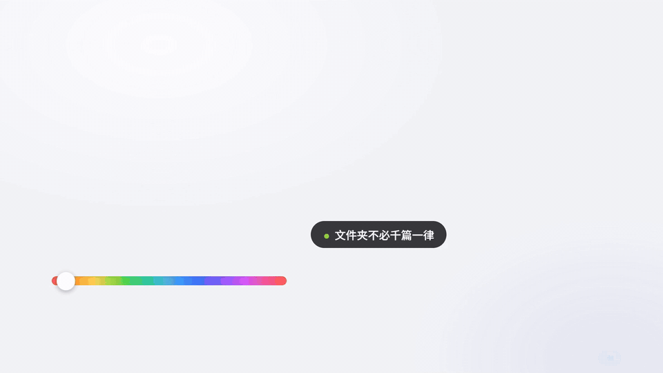
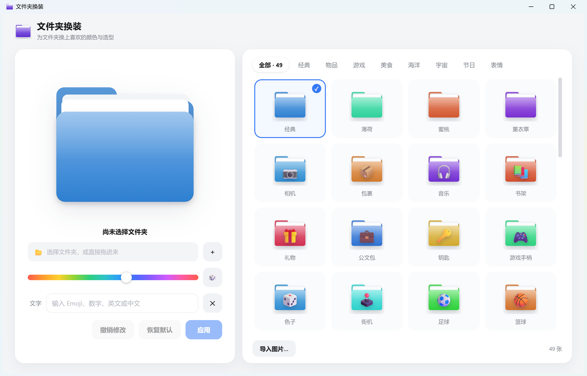

# 文件夹换装 · Windows 版



<sub>发布片由 <a href="https://github.com/alchaincyf/huashu-motion">huashu-motion</a> 全代码生成</sub>

给 Windows 文件夹换上喜欢的颜色与造型 —— moonvy [「文件夹换装」](https://moonvy.com/apps/dir-hz/) 的 Windows 原生实现。



## 功能

- **生成器**：彩虹色相滑杆 + 文字压印（支持 Emoji、中文、英文、数字），实时预览
- **预设图库**：9 个分类 · 49 张预设（经典/物品/游戏/美食/海洋/宇宙/节日/表情），全部本机绘制，无网络依赖
- **皮肤包**：放入 `%APPDATA%\文件夹换装\packs\<包名>\` 的图片文件夹会自动成为一个分类；「批量添加…」可把任意图片文件夹注册为新分类
- **导入图片**：把任意图片作为文件夹封面
- **应用到文件夹**：一键写入，资源管理器立即可见；支持**撤销**与**恢复默认**
- **拖拽**：拖入文件夹直接选中，拖入图片直接当封面

> 皮肤包版权注记：爬取的 NFT 图片（如 OpenSea 合集）版权归各创作者，仅限个人本地使用，请勿随应用再分发。

## 在线预览

**在线预览（官网，含发布片与下载）：<https://folder-dressup.wispbyte.app>**

## 两个版本

| 版本 | 体积 | 说明 |
|---|---|---|
| **轻量版（推荐）** | **3.7 MB** 单文件 | Tauri + Rust，免安装双击即用 |
| 标准版 | 86.6 MB | Electron，兼容性兜底 |

两者的界面、皮肤包目录（`%APPDATA%文件夹换装packs`）完全一致，可共用。

## 运行

```bash
npm install                # 若 electron 二进制未就绪：node node_modules/electron/install.js
npm start                  # 开发运行
npm run verify             # 测试套件（33 用例：绘制/ico/ini/真实文件夹幂等）
npm run dist               # 打包 Electron 版
scripts/build-tauri.bat    # 编译 Tauri 轻量版（需 VS Build Tools + Rust）
```

## 实现原理（Windows 集成）

1. Canvas 绘制 1024px 主图，逐级减半导出 16–256 共 7 个尺寸，打包成 `.ico`
2. 图标写入目标文件夹内的隐藏文件 `.diricon.ico`（随文件夹移动而保留）
3. `desktop.ini`（UTF-16LE BOM）写入 `[.ShellClassInfo] IconResource=...`，保留原有内容
4. 文件夹加 System 属性、desktop.ini 加隐藏+系统属性
5. `SHChangeNotify(SHCNE_UPDATEDIR)` 让资源管理器立即刷新
6. 「恢复默认」移除 IconResource、删除图标文件，其余内容原样保留；应用操作幂等

## 目录

```
main.js               Electron 主进程（IPC 边界校验）
preload.js            contextBridge 暴露的最小 API
lib/draw-folder.js    纯 Canvas 绘制（渲染器与打包脚本共用）
lib/ico.js            PNG → ICO 打包
lib/apply.js          desktop.ini / attrib / SHChangeNotify（幂等）
lib/render-icon.js    Node 侧多尺寸渲染
renderer/             UI（生成器 + 图库）
scripts/              verify 测试套件 / e2e 外壳验证 / 打包图标
AGENTS.md             本任务工作流规范（ub-mode + Tw93 20 条规则沉淀）
WORKLOG.md            工作日志
```
